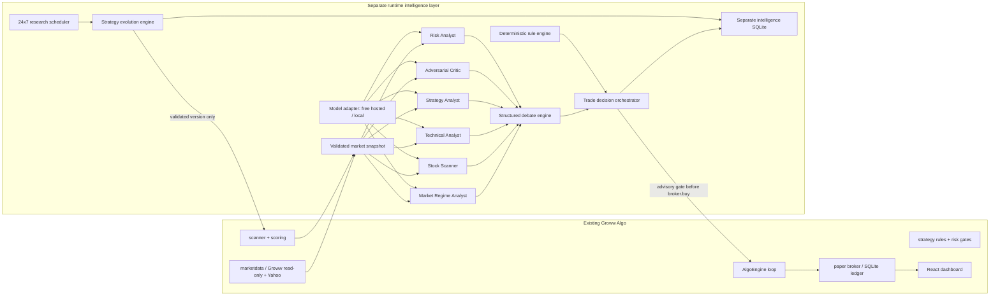

# Autonomous Runtime Intelligence Layer — Design Checkpoint

Branch: `ai-intelligence` · Baseline commit: `bc2136f` · Status: Phase 1 complete, Phase 2 design approved for implementation.

## 1. Baseline preserved

- Existing FastAPI backend, React/Vite frontend, SQLite ledger, Groww read-only data client, paper broker, scanner, scoring and V4 config remain in place.
- Baseline invariants: score maximum 100, minimum entry score 85, minimum R:R 2.0, LONG/SHORT configured, paper-only execution, 5× intraday leverage, capital ₹10,000, risk ₹100, daily loss cap ₹300.
- No real order endpoint, credential access, or live execution path is added.
- Note: current runtime implements LONG entries only; `short_entry` is configured but not executed. The intelligence layer must not silently create live shorts.

## 2. Architecture

## 3. File ownership (parallel work guard)

| Owner | Files |
|---|---|
| Core backend | `engine/intelligence/models.py`, `storage.py`, `config.py`, `snapshot.py`, `rule_engine.py`, `debate.py`, `orchestrator.py` |
| Model layer | `engine/intelligence/model_adapter.py`, `prompts.py`, `agents.py` |
| Evolution/runtime | `engine/intelligence/evolution.py`, `scheduler.py`, `api.py` |
| Integration | `engine/api.py`, `engine/engine.py`, `config/strategy.yaml`, `config/strategy.default.yaml`, `requirements.txt`, `README.md` |
| Frontend | `frontend/src/**`, `frontend/dist/**` |
| QA/Security | `tests/**`, `docs/ai-testing-report.md`, `docs/ai-security-audit.md` |

No two implementation agents may edit the same file. Shared contracts in `models.py` are frozen before parallel work starts.

## 4. Config block

Add `intelligence:` to both strategy YAML files:

- `enabled`, `require_for_entries`, `fail_closed`
- `model`: provider, base_url, model, api_key_env, timeout, retries, rate limit, structured output, `allow_paid: false`, optional local endpoint
- `debate`: rounds, critical objection blocks
- `evolution`: research enabled, interval, auto-promote, validation thresholds, shadow sessions
- `scheduler`: holiday file, research 24×7, market hours only for scanning/execution
- `storage`: separate SQLite path

Secrets are referenced by environment-variable name only. They are never copied into config, prompts, model messages, logs, API responses or the browser.

## 5. Contracts

### MarketSnapshot
Timestamped IST snapshot built only from real `scanner.scan()`, `marketdata.health()`, ledger and config reads. Every candidate carries `source`, `as_of`, `delayed`, `data_stale`, `quote_age_sec`, `score`, `buckets`, indicators and deterministic `build_entry` result. Missing values are explicit `None` plus `missing_information`.

### AgentReport
`agent_id`, `agent_name`, `symbol`, `snapshot_id`, `ts`, `status`, `summary`, `evidence[]`, `missing_information[]`, `uncertainty` 0..1, `confidence` 0..1, `objections[]`, `recommendation` (`support|oppose|abstain`). Agents cannot invent prices or guarantee returns.

### DebateResult
All six reports, rounds, resolved/unresolved objections, consensus score, and `decision` (`approve_candidate|reject_candidate|insufficient_evidence`). Any unresolved critical objection rejects a new candidate. The Critic and Risk Analyst run independently and cannot be suppressed by other agents.

### RuleDecision
Deterministic checks only: market session, data freshness, entry conditions, score ≥85, R:R ≥2, valid stop/target, position size, exposure, daily loss, duplicate position. Calls existing `strategy.build_entry`, `strategy.can_open_new`, `broker.size_position` and ledger reads. It never calls `broker.buy`.

### TradeDecision
Final orchestrator output: `ALLOW|REJECT`, `snapshot_id`, `debate`, `rule_decision`, rationale, model usage IDs and timestamp. Persisted before execution.

## 6. Safety rules

1. Existing positions continue to be managed by deterministic `AlgoEngine.manage_positions()` and `strategy.check_exit()` even if AI fails.
2. If `require_for_entries=true` and model/debate/rule analysis fails or is incomplete, new entries are rejected. No silent fallback to unassisted trading.
3. Agents receive sanitized snapshots only. No credentials, environment variables, broker clients or order methods are exposed.
4. Agents cannot change risk limits, execution permissions, kill switches or active config.
5. Strategy evolution is deterministic code, not an LLM action. No candidate is promoted unless walk-forward, out-of-sample, cost/slippage and shadow checks pass. Previous active version is always retained for rollback.
6. A single additive hook in `AlgoEngine.run_scan()` asks the orchestrator for a decision before `broker.buy`. With `intelligence.enabled=false`, existing behavior is byte-identical.

## 7. Phase gates and evidence

- Phase 2: config + storage + model adapter contracts; evidence: config parse, schema smoke, health check with invalid key.
- Phase 3: six agents produce schema-valid reports on a fixture snapshot; evidence: unit tests.
- Phase 4: debate rejects on critical objection; evidence: unit test.
- Phase 5: rule engine rejects stale data, low score, duplicate, daily loss; evidence: unit tests.
- Phase 6: orchestrator hook integrated; evidence: scratch-DB smoke showing reject on AI failure and paper-only buy path unchanged.
- Phase 7: evolution validates a synthetic candidate, promotes only after checks, rolls back; evidence: tests.
- Phase 8: new Intelligence tab and API; evidence: build + browser smoke.
- Phase 9: no production deploy until QA/security sign-off and explicit approval.
- Phase 10: validation reports and known limitations.
